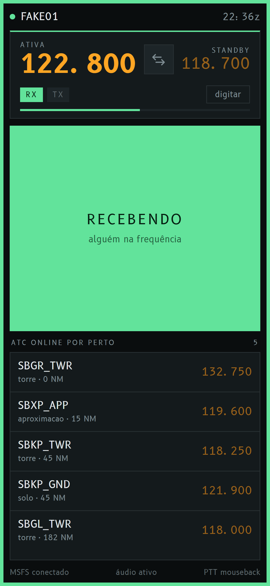
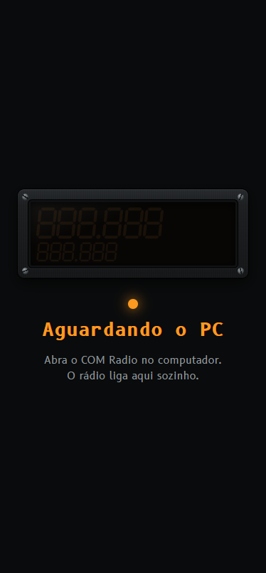
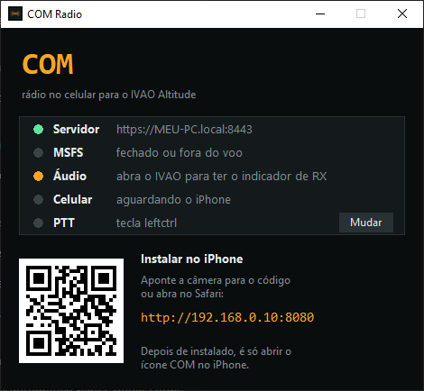

# COM — o iPhone como painel de rádio para a IVAO

[](LICENSE)


**[Read in English](README.md)**

O COM transforma o iPhone num rádio de cockpit para voar na rede IVAO com o
Microsoft Flight Simulator: um botão grande de PTT, frequência ativa e
standby com botão de troca, e a lista de ATC online por perto, ordenada por
distância. Tocar num controlador manda a frequência dele para o standby, como
num rádio de verdade.

O áudio e o microfone continuam no PC. O celular é só o painel.

<p align="center">
  
  &nbsp;
  
</p>
<p align="center">
  
</p>

## O que faz

- **PTT** pelo celular, com proteção contra tecla presa: se o Wi-Fi cair com
  o botão apertado, o PC solta a tecla em 700 ms, e você nunca fica
  transmitindo sem querer.
- **Frequência ativa e standby** lidas e escritas no simulador. Troca como no
  rádio real, com canais de 8.33 kHz.
- **ATC por perto**, pelos dados públicos da IVAO, ordenado pela distância do
  seu avião. Tocar num controlador carrega a frequência no standby.
- **Indicador de recepção.** A moldura inteira da tela fica verde quando
  alguém fala e vermelha quando é você, legível pelo canto do olho com o
  celular num suporte.
- **Jeito de app.** Adicione à tela de início uma vez: abre em tela cheia e
  mostra "Aguardando o PC" até você abrir o COM no computador, e aí o rádio
  aparece sozinho.
- **Sem configurar som.** Sem cabo virtual e sem roteamento: o COM observa o
  volume do IVAO no mixer do Windows para saber quando alguém está falando.

## Como funciona

O app de pilotos da IVAO não tem API, então o COM nunca fala com a IVAO. Ele
age no PC por fora, do mesmo jeito que os addons de PTT para joystick:

| O quê | Como |
|---|---|
| PTT | Aperta a tecla que você já configurou como PTT na IVAO, pelo `SendInput` do Windows com scancode (funciona com o simulador em tela cheia) |
| Frequências | Lê e escreve o rádio COM do simulador pelo SimConnect; a IVAO segue o rádio do simulador |
| Luz de recepção | Lê o pico de volume do IVAO no mixer de áudio do Windows |
| Lista de ATC | API pública Whazzup da IVAO, a cada 15 s |

```
iPhone (app web na tela de início, guardado pelo service worker)
   │  WebSocket por HTTPS no seu Wi-Fi, com certificado local
   ▼
COM Radio.exe ── um estado só, enviado 10 vezes por segundo
   ├── ptt.py       SendInput com scancode
   ├── sim.py       SimConnect: lê rádio e posição, escreve standby e troca
   ├── audio.py     pico do IVAO no mixer do Windows, com squelch
   ├── whazzup.py   API pública da IVAO, distância por haversine
   └── certs.py     autoridade certificadora local, para o Safari aceitar HTTPS
```

O Safari só mantém um app web funcionando sem conexão em HTTPS, então o COM
cria uma pequena autoridade certificadora no seu PC. Você confia nela no
iPhone uma vez.

## Requisitos

- Windows 10 ou 11 com o Microsoft Flight Simulator 2020
- O app de pilotos da IVAO, com uma tecla de PTT configurada
- Um iPhone no mesmo Wi-Fi que o PC

## Começo rápido

1. Baixe o `COM-Radio-windows.zip` da
   [última release](../../releases/latest) e extraia onde quiser.
2. Abra o `COM Radio.exe`.
   - O exe não tem assinatura digital, então o SmartScreen do Windows pode
     avisar na primeira vez: clique em **Mais informações › Executar assim
     mesmo**.
   - O Firewall do Windows vai perguntar sobre a rede: libere em **Redes
     privadas**, senão o iPhone não alcança o PC.
3. **Defina a tecla de PTT:** clique em **Mudar** na linha do PTT da janela e
   aperte a tecla ou o botão do mouse que você usa como PTT na IVAO. O COM
   reconhece e salva sozinho; não precisa saber o nome da tecla.
4. **No iPhone, uma vez só:** aponte a câmera para o QR code da janela (ou
   abra no Safari o endereço `http://…:8080` que ela mostra) e siga os quatro
   passos da página:
   1. baixe o certificado;
   2. instale em **Ajustes › Perfil Transferido**;
   3. ligue em **Ajustes › Geral › Sobre › Ajustes de Confiança de
      Certificados**;
   4. quando a página mostrar o botão verde, abra o rádio e use
      **Compartilhar › Adicionar à Tela de Início**.

Daí em diante: abra a IVAO, abra o COM, toque no ícone COM no celular e voe.

O certificado fica em `%APPDATA%\COM Radio\certs`. Não apague essa pasta: sem
ela, o PC cria outro certificado e o iPhone precisa repetir o passo 4.

## Configuração

Tudo fica no `config.json`, ao lado do exe.

| Chave | Padrão | O que faz |
|---|---|---|
| `ptt_key` | `leftctrl` | Tecla apertada no PTT. O jeito fácil é o botão **Mudar** da janela. À mão: letras, números, `f1` a `f24`, teclas do numpad, modificadoras (`leftctrl`, `rightalt`…) ou botões do mouse `mouseback`, `mouseforward`, `mousemiddle`. Lista completa: `SCANCODES` no `app/ptt.py` |
| `ptt_deadman_ms` | `700` | Solta o PTT se o celular ficar esse tempo sem dar sinal |
| `audio_process` | `["ivao", "altitude"]` | Qualquer pedaço do caminho do programa cujo volume quer dizer "alguém falando" |
| `squelch_open` / `squelch_close` | `0.03` / `0.01` | Nível que acende / apaga a luz de recepção |
| `squelch_hang_ms` | `350` | Segura a luz acesa nas pausas curtas da fala |
| `whazzup_radius_nm` | `250` | Até que distância procurar ATC |
| `whazzup_max_stations` | `12` | Quantos controladores listar |
| `port` / `setup_port` | `8443` / `8080` | Rádio (HTTPS) e página de instalação (HTTP) |
| `sim_enabled`, `audio_enabled`, `whazzup_enabled` | `true` | Desligam uma parte |

Dicas para a tecla de PTT:

- Se o Ctrl esquerdo faz outra coisa no seu simulador, `f13` é uma boa
  escolha: nenhum programa usa.
- Com `mouseback`, a janela em foco também recebe um "voltar" de verdade.
  Dentro do simulador não faz nada, mas um navegador na frente volta uma
  página a cada transmissão.

## Segurança

Um PTT preso travaria a frequência para todo mundo, então soltar a tecla tem
cinco caminhos: o celular manda um sinal a cada 200 ms enquanto você segura o
botão e o PC solta depois de 700 ms sem sinal; o celular também solta quando
o app vai para segundo plano, quando perde o foco e quando a página fecha, e o
PC solta na desconexão e no encerramento. Com dois celulares abertos, só o
primeiro a apertar controla o PTT até soltar.

## Se algo não funcionar

**O PTT não transmite.** Rode `py app/server.py --test-ptt`. Se ele disser que a
tecla saiu e a IVAO continuar muda, o `ptt_key` não bate com o PTT
configurado na IVAO. Erro 5 quer dizer que a IVAO ou o simulador rodam como
administrador e o COM não: abra o COM como administrador também. Com o
simulador em tela cheia exclusiva, teste em janela sem bordas.

**"MSFS fechado" com o simulador aberto.** Carregue um voo até estar no
cockpit; no menu principal o simulador não responde às variáveis do rádio.

**A frequência não muda.** Confira a energia da aviônica: o simulador ignora
escrita de rádio com a aviônica desligada. O `py app/server.py --test-sim`
escreve uma frequência, confere se entrou, troca e devolve tudo como estava.

**"Abra o IVAO para ter o indicador de RX" com o IVAO aberto.** Rode
`py app/server.py --list-audio` com alguém falando na frequência. Ele lista todo
programa tocando som e o nível de cada um; ponha um pedaço do caminho do
certo em `audio_process`.

**A luz de recepção pisca ou nunca acende.** Rode `py app/server.py --meter`,
olhe o nível quando alguém fala e ponha `squelch_open` um pouco abaixo dele e
`squelch_close` mais ou menos na metade. O nível acompanha o volume do IVAO
no Windows.

**A lista de ATC fica vazia.** Aumente o `whazzup_radius_nm`.

## Rodar pelo código

Precisa de Python 3.12 ou mais novo, no Windows.

```bash
py -m pip install -r requirements.txt
py app/gui.py
```

O `py app/server.py` roda o mesmo servidor num terminal, com modos de
diagnóstico:

| Comando | O que faz |
|---|---|
| `py app/server.py --doctor` | Confere PTT, áudio, dados da IVAO e simulador, e diz o que falta. **Aperta a tecla de PTT de verdade** |
| `py app/server.py --test-ptt` | Aperta e solta a tecla de PTT e confirma que o Windows viu |
| `py app/server.py --test-sim` | Escreve no standby do COM1 do simulador, troca e devolve tudo |
| `py app/server.py --list-audio` | Lista os programas tocando som, para achar o da IVAO |
| `py app/server.py --meter` | Nível de recepção ao vivo, para ajustar o squelch |
| `py app/server.py --fake-sim` | Roda com um simulador falso, para mexer na interface |

O `build.bat` gera o `dist\COM Radio.exe` com o PyInstaller.

A interface é HTML, CSS e JavaScript puros em `app/static/`, sem etapa de build.
A fonte é a [B612](https://b612-font.com/), desenhada pela Airbus para
displays de cockpit.

## Aviso

O COM é um projeto independente, sem vínculo nem aprovação da IVAO. Ele não
se conecta aos servidores da IVAO nem mexe no protocolo dela: só aperta uma
tecla, fala com o simulador pelo SimConnect e lê dados públicos.

## Licença

[MIT](LICENSE) © 2026 Bernardo Vignatti
